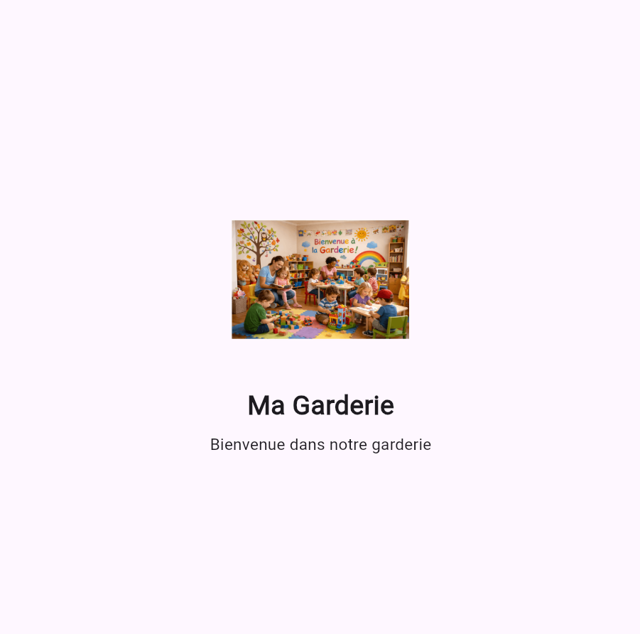
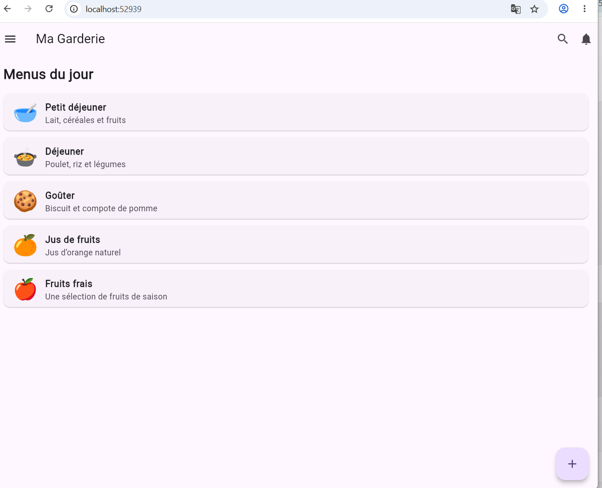
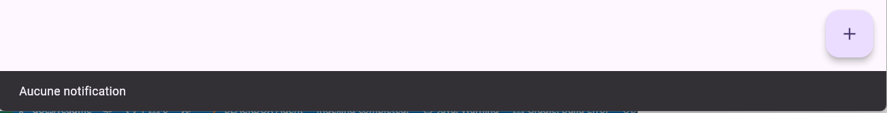

# 🌸 Ma Garderie

## 📌 Présentation

Ma Garderie est une application mobile développée avec Flutter pour consulter les menus proposés dans une garderie d'enfants.

## ✨ Fonctionnalités

- Splash Screen
- Page principale
- Affichage des menus
- Drawer de navigation
- Recherche
- Notifications
- Ajout d'un menu
- Sélection d'un menu

## 🛠️ Technologies utilisées

- Flutter
- Dart
- Git
- GitHub

## 📱 Captures d'écran

### Splash Screen


### Page d'accueil


### Drawer de navigation


### Interaction


## ⚙️ Installation

**1. Cloner le projet**

```bash
git clone https://github.com/roua4605/garderie-mobile-g2.git
```

**2. Accéder au dossier**

```bash
cd garderie-mobile-g2
```

**3. Installer les dépendances**

```bash
flutter pub get
```

**4. Lancer l'application**

```bash
flutter run
```

## 👩‍💻 Réalisé avec Flutter

